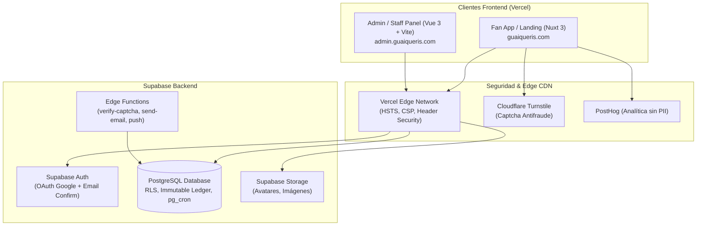

# Arquitectura del Sistema — Guaiqueríes de Margarita

## Diagrama de Arquitectura Global

---

## Esquema de Base de Datos y Módulos Principales

1. **Usuarios y Autenticación**: `profiles`, `staff_members`, `user_segments`.
2. **Economía e Inmutabilidad**: `wallets`, `ledger_entries` (Append-Only), `economy_settings`.
3. **Trivias y Participación**: `trivias`, `trivia_questions`, `trivia_options`, `trivia_attempts`.
4. **Tienda y Canjes**: `products`, `redemptions`, `inventory_movements`.
5. **Antifraude y Auditoría**: `captcha_passes`, `risk_flags`, `held_pearls`, `audit_logs`, `system_alerts`.
6. **Contenido Público**: `site_announcements`, `carousel_slides`, `history_milestones`, `site_team_members`, `faqs`, `site_stats`, `policy_documents`.
