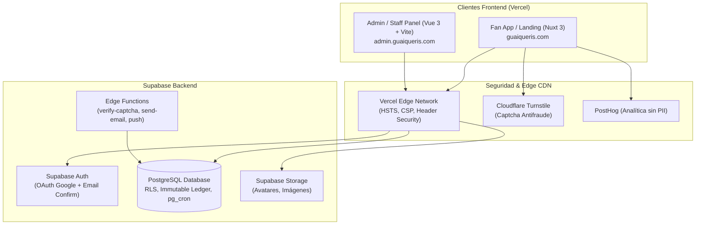
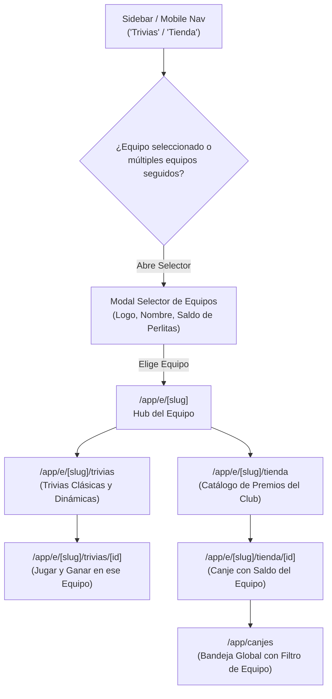

# Arquitectura del Sistema — Guaiqueríes de Margarita

## Diagrama de Arquitectura Global

---

## Esquema de Base de Datos y Módulos Principales

1. **Multi-Tenancy y Directorio de Equipos**: `teams`, `teams_public`, `team_follows`.
2. **Usuarios y Control de Acceso (RBAC + Multi-Tenant)**:
   - `profiles`: Identidad única del fanático compartida en la plataforma.
   - `staff_members`: Empleados de club (`team_id NOT NULL`) y administradores de plataforma (`team_id IS NULL`).
   - `team_follows`: Relación explícita fanático-equipo que habilita ganar perlitas y recibir beneficios.
3. **Economía e Inmutabilidad Multi-Equipo**:
   - `wallets`: Billetera aislada por equipo `(fan_id, team_id)` con `balance_cache`.
   - `ledger_entries`: Libro contable append-only inmutable (`team_id NOT NULL`).
   - `economy_settings`: Topes globales por usuario sumando todos los equipos y reglas de economía.
4. **Trivias y Participación**: `trivias`, `trivia_questions`, `trivia_options`, `trivia_attempts` (acotados por `team_id`).
5. **Tienda y Canjes**: `products`, `redemptions`, `redemption_history` (catálogo y canjes aislados por club).
6. **Antifraude y Auditoría**: `risk_flags` (mixta: club ve banderas de su equipo, plataforma ve todas), `held_pearls`, `audit_log`, `system_alerts`.
7. **Contenido Público**: `site_announcements`, `carousel_slides`, `history_milestones`, `site_team_members`, `faqs`, `site_stats`, `policy_documents`.

---

## Arquitectura de Navegación por Equipo en la Web del Fanático (Fase 3)

### Principios de Aislamiento y Experiencia de Usuario:
1. **Rutas Jerárquicas**:
   - `/app/e/[slug]`: Hub principal del equipo con información, estado (activo/inactivo), saldo y pestañas directas.
   - `/app/e/[slug]/trivias` y `/app/e/[slug]/trivias/[id]`: Catálogo y ejecución de trivias del equipo.
   - `/app/e/[slug]/tienda` y `/app/e/[slug]/tienda/[id]`: Catálogo y canjes validados contra el saldo del club.
   - `/app/canjes`: Bandeja consolidada de todos los canjes del fanático, con filtro por equipo y badge distintivo de cada club.
2. **Team Picker Modal (`useCurrentTeam`)**:
   - Intercepta los accesos a "Trivias" o "Tienda" desde el menú global. Muestra las tarjetas de los equipos seguidos con su saldo respectivo.
   - Si el fanático no sigue a ningún club, ofrece un estado vacío amigable con enlace directo a `/app/equipos`.
3. **Resiliencia en el Almacenamiento Local**:
   - El slug del equipo activo se almacena en `localStorage` (`guaiqui_active_team_slug`) estrictamente como conveniencia UX dentro de bloques `try/catch`. El backend **nunca** asume este valor y deriva el `team_id` directamente del recurso (trivia o producto) consultado o jugado.
4. **Tratamiento de Equipos Inactivos**:
   - Si un equipo pasa a estado `inactive`, el Hub y sus subrutas muestran un banner preventivo que bloquea la participación en trivias y canjes nuevos, preservando intactos la visibilidad del historial y los saldos.
