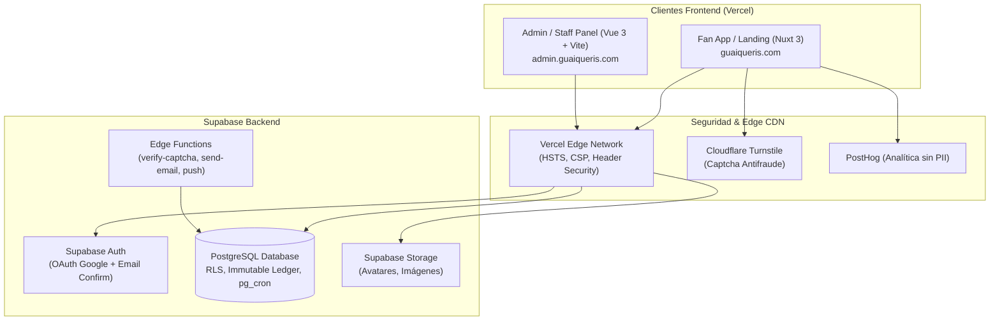

# Arquitectura del Sistema — Guaiqueríes de Margarita

## Diagrama de Arquitectura Global

---

## Esquema de Base de Datos y Módulos Principales

1. **Multi-Tenancy y Directorio de Equipos**: `teams`, `teams_public`, `team_follows`.
2. **Usuarios y Control de Acceso (RBAC + Multi-Tenant)**:
   - `profiles`: Identidad única del fanático compartida en la plataforma.
   - `staff_members`: Empleados de club (`team_id NOT NULL`) y administradores de plataforma (`team_id IS NULL`).
   - `team_follows`: Relación explícita fanático-equipo que habilita ganar perlitas y recibir beneficios.
3. **Economía e Inmutabilidad Multi-Equipo**:
   - `wallets`: Billetera aislada por equipo `(fan_id, team_id)` con `balance_cache`.
   - `ledger_entries`: Libro contable append-only inmutable (`team_id NOT NULL`).
   - `economy_settings`: Topes globales por usuario sumando todos los equipos y reglas de economía.
4. **Trivias y Participación**: `trivias`, `trivia_questions`, `trivia_options`, `trivia_attempts` (acotados por `team_id`).
5. **Tienda y Canjes**: `products`, `redemptions`, `redemption_history` (catálogo y canjes aislados por club).
6. **Antifraude y Auditoría**: `risk_flags` (mixta: club ve banderas de su equipo, plataforma ve todas), `held_pearls`, `audit_log`, `system_alerts`.
7. **Contenido Público**: `site_announcements`, `carousel_slides`, `history_milestones`, `site_team_members`, `faqs`, `site_stats`, `policy_documents`.
