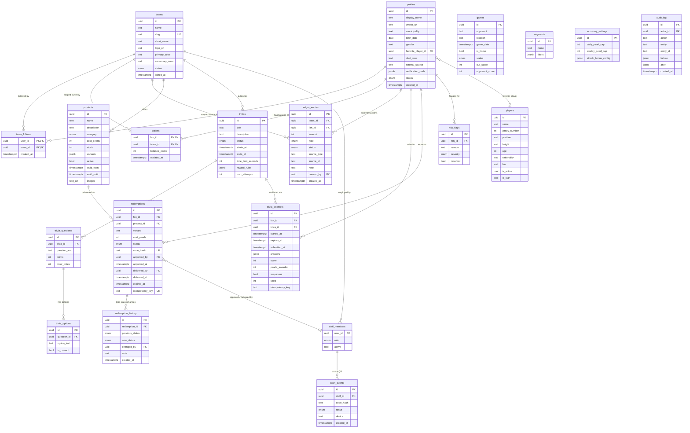

# Supabase Database Schema — Guaiqueríes de Margarita

Plataforma de fidelización de fanáticos para **Guaiqueríes de Margarita**.

## Modelo de Entidad-Relación

## Enums

| Enum               | Valores                                                                                           |
|---------------------|---------------------------------------------------------------------------------------------------|
| `user_status`       | `active`, `suspended`                                                                             |
| `staff_role`        | `staff`, `admin`                                                                                  |
| `ledger_type`       | `trivia_reward`, `redemption`, `refund`, `admin_adjustment`, `bonus`, `streak_bonus`               |
| `ledger_status`     | `confirmed`, `held`, `revoked`                                                                    |
| `trivia_status`     | `draft`, `published`, `archived`                                                                  |
| `product_category`  | `physical`, `experience`, `raffle`                                                                |
| `redemption_status` | `pending`, `approved`, `scheduled`, `delivered`, `completed`, `cancelled`, `rejected`, `issue`, `expired` |
| `scan_result`       | `success`, `invalid`, `already_delivered`, `expired`                                              |
| `game_status`       | `scheduled`, `live`, `finished`, `cancelled`                                                      |
| `risk_severity`     | `low`, `medium`, `high`                                                                           |

## Reglas Inmutables de la Economía de Perlitas Multi-Equipo

1. **Perlitas Propias por Equipo y Billeteras Aisladas**:
   - Cada equipo posee su propia moneda virtual ("perlitas"). No hay transferencia ni combinación persistida de saldos entre equipos.
   - El saldo total del fanático es una suma puramente calculada al vuelo (`get_wallet_summary()`), nunca almacenada globalmente.
   - La tabla `wallets` utiliza una clave primaria compuesta `(fan_id, team_id)`. Se inicializa automáticamente cuando el fanático sigue a un equipo (`follow_team`).
   - Las perlitas de un equipo solo son canjeables por productos y experiencias de ese mismo equipo.

2. **Libro Contable Inmutable (`ledger_entries`) Multi-Equipo**:
   - `UPDATE` y `DELETE` están estrictamente bloqueados a nivel de motor PostgreSQL (`prevent_ledger_mutation()`).
   - Cada entrada contable está vinculada a un equipo obligatorio (`team_id UUID NOT NULL REFERENCES public.teams(id)`).
   - Para ganar perlitas de un equipo, el fanático debe seguir activamente al equipo (`team_follows`) y el equipo debe estar `active`.
   - Si un fanático deja de seguir a un equipo, su billetera y su saldo acumulado NO se borran ni congelan: conserva el derecho a canjear premios de ese equipo.
   - Si un equipo pasa a estado `inactive`, se bloquean nuevas ganancias y canjes, pero los saldos y el historial histórico se conservan visibles.

3. **Seguimiento de Equipos (`team_follows`)**:
   - Clave primaria `(user_id, team_id)`. Los fanáticos gestionan sus propios follows mediante las RPCs idempotentes `follow_team` y `unfollow_team` con rate limiting (30 operaciones / 60 segundos).
   - El staff de club solo puede consultar agregados anónimos (`team_follower_count(team_id)`); no tiene visibilidad de la lista cruda de seguidores.

4. **Evaluación 100% en Servidor**:
   - Las soluciones de las trivias (`trivia_options.is_correct`) nunca viajan al cliente antes de enviar las respuestas.
   - `start_trivia_attempt` y `submit_trivia_attempt` derivan el `team_id` directamente del recurso padre, verifican el seguimiento activo y otorgan perlitas a la billetera `(fan_id, team_id)` en una transacción atómica.
   - Detección de comportamiento sospechoso: si el tiempo de resolución es < 3 segundos, los puntos se retienen en `held` y se crea un `risk_flag`.

5. **Canjes Atómicos y Prevención de Doble Entrega**:
   - La función `redeem_product` deriva el `team_id` del producto, bloquea la billetera correspondiente (`FOR UPDATE`) y el producto, valida existencia y saldo suficiente, genera el código hash y descuenta perlitas y stock de forma atómica.
   - Cancelaciones y reembolsos reinsertan transacciones positivas en `ledger_entries` vinculadas al `team_id` original.

## Funciones RPC Transaccionales

| Función | Descripción | Bloqueo |
|---------|-------------|---------|
| `follow_team(p_team_id)` | Fan sigue a un equipo activo. Idempotente, crea wallet si no existe. Con rate limiting. | — |
| `unfollow_team(p_team_id)` | Fan deja de seguir a un equipo. Idempotente, no altera balances ni ledger. | — |
| `search_teams(p_query, p_limit, p_offset)` | Búsqueda pública de equipos activos con conteo de seguidores y estado `is_following`. | — |
| `get_wallet_summary()` | Resumen unificado: saldo total calculado + desglose por equipo con balances y flags. | — |
| `start_trivia_attempt(trivia_id, idempotency_key)` | Crea intento con expiración y semilla de barajado. Idempotente. | — |
| `submit_trivia_attempt(attempt_id, answers, idempotency_key)` | Evalúa en servidor, valida seguimiento activo, acredita a `(fan_id, team_id)`. | `FOR UPDATE` en attempt |
| `redeem_product(product_id, variant, idempotency_key)` | Verifica saldo en `(fan_id, team_id)` del producto, descuenta atómicamente, genera QR. | `FOR UPDATE` en wallet + product |
| `cancel_redemption(redemption_id, reason)` | Reembolsa perlitas al wallet del equipo del canje y repone stock. | `FOR UPDATE` en redemption |
| `claim_birthday_bonus(p_team_id)` | Otorga bono de cumpleaños una vez al año por equipo seguido y activo. | `FOR UPDATE` en wallet |
| `approve_redemption(redemption_id, note)` | Staff del equipo aprueba canje pendiente de su equipo. | `FOR UPDATE` en redemption |
| `reject_redemption(redemption_id, reason)` | Staff rechaza y reembolsa perlitas + stock al equipo del canje. | `FOR UPDATE` en redemption |
| `deliver_redemption(code_hash, device)` | Entrega por escaneo QR. Previene doble entrega. | `FOR UPDATE` en redemption |
| `report_redemption_issue(redemption_id, reason)` | Staff reporta problema con entrega. | `FOR UPDATE` en redemption |
| `verify_redemption_code(code_hash)` | Lectura de la tarjeta del canje, sin consumir. | — |
| `admin_adjust_pearls(fan_id, amount, reason, team_id)` | Ajuste manual acotado por equipo de staff (o especificado por plataforma). | `FOR UPDATE` en wallet |
| `reconcile_wallets()` | Auditor contable: concilia `balance_cache` vs `ledger_entries` por `(fan_id, team_id)`. | — |

## RLS (Row-Level Security)

| Tabla | Fan | Staff | Admin |
|-------|-----|-------|-------|
| `profiles` | Lee/edita solo su perfil | Lee todos | Todo |
| `wallets` | Lee solo su billetera | Lee todas | Todo |
| `ledger_entries` | Lee solo sus entradas | Lee todas | Todo |
| `trivias` | Lee publicadas/archivadas | Lee todas | Todo |
| `trivia_options` | Lee texto (sin `is_correct` vía RPC) | Lee todas | Todo |
| `trivia_attempts` | Lee solo las suyas | Lee todas | Todo |
| `products` | Lee activos | Edita stock | Todo |
| `redemptions` | Lee solo los suyos | Gestiona todos | Todo |
| `players` | Lee activos | Lee activos/inactivos | Todo |
| `games` | Lee todos | Lee todos | Todo |
| `segments`, `economy_settings`, `risk_flags`, `audit_log` | — | — | Todo |
| `scan_events` | — | Lee/crea | Todo |

> **Nadie** escribe directamente en `ledger_entries` ni `wallets` desde el cliente. Toda escritura pasa por funciones `SECURITY DEFINER`.

## Pruebas de Integridad

Archivo: `supabase/tests/test_integrity.sql`

| # | Test | Qué verifica |
|---|------|-------------|
| 1 | Ledger UPDATE bloqueado | Trigger rechaza `UPDATE` en `ledger_entries` |
| 2 | Ledger DELETE bloqueado | Trigger rechaza `DELETE` en `ledger_entries` |
| 3 | Balance no negativo | CHECK `balance_cache >= 0` en `wallets` |
| 4 | Costo de producto > 0 | CHECK `cost_pearls > 0` en `products` |
| 5 | Idempotency key única | UNIQUE `(fan_id, idempotency_key)` en `redemptions` |
| 6 | Pago duplicado bloqueado | Índice único parcial en `ledger_entries` |
| 7 | Canje concurrente | Solo 1 de 2 canjes con saldo justo pasa |
| 8 | Doble entrega | Conditional UPDATE afecta 0 filas en segundo intento |
| 9 | Cache = SUM(ledger) | `balance_cache == SUM(amount) WHERE confirmed` |
| 10 | Trivia duplicada | UNIQUE `(fan_id, trivia_id, idempotency_key)` |
| 11 | code_hash único | UNIQUE `code_hash` en `redemptions` |
| 12 | Stock no negativo | CHECK `stock >= 0` en `products` |
