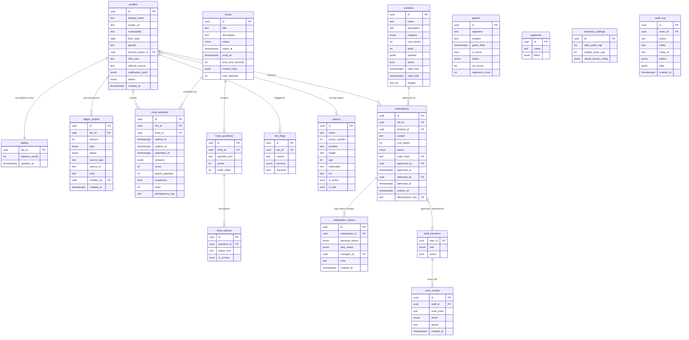

# Supabase Database Schema — Guaiqueríes de Margarita

Plataforma de fidelización de fanáticos para **Guaiqueríes de Margarita**.

## Modelo de Entidad-Relación

## Enums

| Enum               | Valores                                                                                           |
|---------------------|---------------------------------------------------------------------------------------------------|
| `user_status`       | `active`, `suspended`                                                                             |
| `staff_role`        | `staff`, `admin`                                                                                  |
| `ledger_type`       | `trivia_reward`, `redemption`, `refund`, `admin_adjustment`, `bonus`, `streak_bonus`               |
| `ledger_status`     | `confirmed`, `held`, `revoked`                                                                    |
| `trivia_status`     | `draft`, `published`, `archived`                                                                  |
| `product_category`  | `physical`, `experience`, `raffle`                                                                |
| `redemption_status` | `pending`, `approved`, `scheduled`, `delivered`, `completed`, `cancelled`, `rejected`, `issue`, `expired` |
| `scan_result`       | `success`, `invalid`, `already_delivered`, `expired`                                              |
| `game_status`       | `scheduled`, `live`, `finished`, `cancelled`                                                      |
| `risk_severity`     | `low`, `medium`, `high`                                                                           |

## Reglas Inmutables de la Economía de Perlitas

1. **Libro Contable Inmutable (`ledger_entries`)**:
   - `UPDATE` y `DELETE` están bloqueados a nivel de base de datos con un disparador (`BEFORE UPDATE OR DELETE ON ledger_entries`).
   - Todos los saldos se derivan de transacciones de suma.
   - La tabla `wallets` mantiene un saldo en caché (`balance_cache`) que solo es alterado mediante funciones transaccionales atómicas con bloqueo de fila (`FOR UPDATE`).
   - Índice único parcial `(source_type, source_id, type) WHERE status = 'confirmed'` previene pagos duplicados.

2. **Evaluación 100% en Servidor**:
   - Las soluciones de las trivias (`trivia_options.is_correct`) nunca viajan al cliente antes de enviar las respuestas.
   - Las funciones `start_trivia_attempt` y `submit_trivia_attempt` evalúan puntos y otorgan perlitas en una única transacción en el servidor.
   - Detección de comportamiento sospechoso: si el tiempo de resolución es < 3 segundos, el intento se marca `suspicious`, los puntos se ponen en estado `held` y se crea un `risk_flag`.

3. **Canjes Atómicos y Prevención de Doble Entrega**:
   - La función `redeem_product` bloquea la billetera y el producto (`FOR UPDATE`), verifica saldo y stock, genera el código QR hash y descuenta perlitas y stock de forma atómica.
   - La función `deliver_redemption` ejecuta una actualización condicional `WHERE status IN ('pending', 'approved', 'scheduled')` para impedir la entrega doble de un mismo código QR.
   - Clave de idempotencia `(fan_id, idempotency_key)` única en `redemptions`.

4. **Transacciones de Reembolso**:
   - Cancelar o rechazar un canje inserta una entrada POSITIVA en `ledger_entries` con `type = 'refund'` y restaura el stock. Nunca borra ni modifica registros existentes.

## Funciones RPC Transaccionales

| Función | Descripción | Bloqueo |
|---------|-------------|---------|
| `start_trivia_attempt(trivia_id, idempotency_key)` | Crea intento con expiración y semilla de barajado. Idempotente. | — |
| `submit_trivia_attempt(attempt_id, answers, idempotency_key)` | Evalúa en servidor, aplica anti-cheat, inserta ledger + wallet atómicamente. | `FOR UPDATE` en attempt |
| `redeem_product(product_id, variant, idempotency_key)` | Verifica saldo/stock, descuenta todo atómicamente, genera código QR. | `FOR UPDATE` en wallet + product |
| `cancel_redemption(redemption_id, reason)` | Fan cancela pendientes; staff cancela pending/approved/scheduled. Reembolsa. | `FOR UPDATE` en redemption |
| `approve_redemption(redemption_id, note)` | Staff aprueba canje pendiente. | `FOR UPDATE` en redemption |
| `reject_redemption(redemption_id, reason)` | Staff rechaza y reembolsa perlitas + stock. | `FOR UPDATE` en redemption |
| `deliver_redemption(code_hash, device)` | Entrega por escaneo QR. Previene doble entrega. | `FOR UPDATE` en redemption |
| `report_redemption_issue(redemption_id, reason)` | Staff reporta problema con entrega. | `FOR UPDATE` en redemption |
| `verify_redemption_code(code_hash)` | Lectura de la tarjeta del canje, sin consumir. | — |
| `admin_adjust_pearls(fan_id, amount, reason)` | Ajuste manual con motivo obligatorio + audit_log. | `FOR UPDATE` en wallet |

## RLS (Row-Level Security)

| Tabla | Fan | Staff | Admin |
|-------|-----|-------|-------|
| `profiles` | Lee/edita solo su perfil | Lee todos | Todo |
| `wallets` | Lee solo su billetera | Lee todas | Todo |
| `ledger_entries` | Lee solo sus entradas | Lee todas | Todo |
| `trivias` | Lee publicadas/archivadas | Lee todas | Todo |
| `trivia_options` | Lee texto (sin `is_correct` vía RPC) | Lee todas | Todo |
| `trivia_attempts` | Lee solo las suyas | Lee todas | Todo |
| `products` | Lee activos | Edita stock | Todo |
| `redemptions` | Lee solo los suyos | Gestiona todos | Todo |
| `players` | Lee activos | Lee activos/inactivos | Todo |
| `games` | Lee todos | Lee todos | Todo |
| `segments`, `economy_settings`, `risk_flags`, `audit_log` | — | — | Todo |
| `scan_events` | — | Lee/crea | Todo |

> **Nadie** escribe directamente en `ledger_entries` ni `wallets` desde el cliente. Toda escritura pasa por funciones `SECURITY DEFINER`.

## Pruebas de Integridad

Archivo: `supabase/tests/test_integrity.sql`

| # | Test | Qué verifica |
|---|------|-------------|
| 1 | Ledger UPDATE bloqueado | Trigger rechaza `UPDATE` en `ledger_entries` |
| 2 | Ledger DELETE bloqueado | Trigger rechaza `DELETE` en `ledger_entries` |
| 3 | Balance no negativo | CHECK `balance_cache >= 0` en `wallets` |
| 4 | Costo de producto > 0 | CHECK `cost_pearls > 0` en `products` |
| 5 | Idempotency key única | UNIQUE `(fan_id, idempotency_key)` en `redemptions` |
| 6 | Pago duplicado bloqueado | Índice único parcial en `ledger_entries` |
| 7 | Canje concurrente | Solo 1 de 2 canjes con saldo justo pasa |
| 8 | Doble entrega | Conditional UPDATE afecta 0 filas en segundo intento |
| 9 | Cache = SUM(ledger) | `balance_cache == SUM(amount) WHERE confirmed` |
| 10 | Trivia duplicada | UNIQUE `(fan_id, trivia_id, idempotency_key)` |
| 11 | code_hash único | UNIQUE `code_hash` en `redemptions` |
| 12 | Stock no negativo | CHECK `stock >= 0` en `products` |
